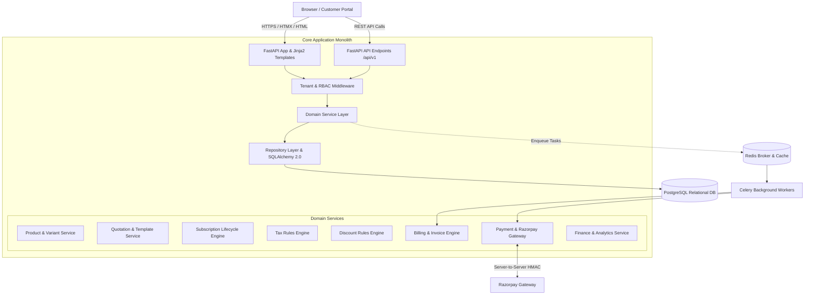

# System Architecture

## Subscription Manager (Multi-Tenant SaaS)

**Document Status:** Architecture Baseline — Fully Aligned  
**Architecture Style:** Modular Monolith with Multi-Tenancy  
**Frontend Pattern:** Hypermedia-Driven (FastAPI + Jinja2 + HTMX)

---

## 1. Architecture Overview

Subscription Manager is a server-rendered, hypermedia-driven web application and API engineered as a high-performance **modular monolith**. It powers the end-to-end subscription, quoting, invoicing, and billing lifecycle for organizations like **Brightloop Software**.

The architecture combines the rapid development and strict data-consistency guarantees of a monolithic relational model with a clean separation of concerns across presentation, domain services, data access, and asynchronous background processing.



---

## 2. Technology Stack

| Layer | Selected Technology | Rationale |
| :--- | :--- | :--- |
| **Language** | Python 3.12 | Modern type hinting, high performance async runtime |
| **Backend Framework** | FastAPI | High-speed ASGI framework, automatic OpenAPI documentation, dependency injection |
| **Frontend Rendering** | Jinja2 Templates | Server-side template rendering, fast first-contentful paint, zero JavaScript bundle build step |
| **Dynamic Frontend** | HTMX | Declarative AJAX, inline element replacement, seamless modals and search without React/Vue overhead |
| **Styling** | Vanilla CSS (Tailored Design System) | Full control over aesthetics, modern dark/light themes, micro-animations, glassmorphism |
| **Relational Database** | PostgreSQL 16+ | ACID compliance, robust indexing, decimal precision, JSONB support for variant attributes |
| **ORM & Migrations** | SQLAlchemy 2.0 + Alembic | Type-safe declarative queries, relationship modeling, version-controlled database migrations |
| **Auth & Cryptography** | JWT + Argon2id | Secure HTTP-only cookies, memory-hard hashing resistant to GPU cracking |
| **Task Queue & Broker** | Celery + Redis | Asynchronous billing day runs, email dispatch, automated expiry enforcement |
| **Payment Gateway** | Razorpay SDK | Secure online transactions with server-side HMAC signature verification |
| **Testing** | Pytest + HTTPX | Fast synchronous and asynchronous API and hypermedia integration tests |
| **Deployment** | Docker & Docker Compose | Reproducible containerized environments for app, db, redis, and workers |

> [!IMPORTANT]
> **No Separate React / Next.js SPA:**  
> In accordance with the project decision, a separate React/Next.js frontend is prohibited. All user-facing views (Internal Admin/Staff dashboards and the Customer Portal) are rendered directly by FastAPI using Jinja2 templates and enriched with HTMX.

---

## 3. Multi-Tenancy Architecture

Subscription Manager uses a **shared database, shared schema with tenant discriminator column** architecture:
1. **Tenant Identity:** Every organization has a unique `organization_id` (UUID).
2. **Tenant Scoping:** All business entities (`products`, `product_variants`, `quotation_templates`, `quotations`, `subscriptions`, `invoices`, `payments`, `tax_rules`, `discount_rules`, `customers`) include a non-nullable foreign key `organization_id REFERENCES organizations(id) ON DELETE RESTRICT`.
3. **Automatic Query Isolation:** The repository layer automatically enforces tenant filtering via FastAPI request dependencies:
   ```python
   # Example tenant dependency
   async def get_current_org(request: Request, user: User = Depends(get_current_user)) -> Organization:
       ...
   ```
4. **Data Leak Prevention:** URLs explicitly identify tenant scope (e.g. `/org/{org_id}/subscriptions/...`), and the backend verifies the authenticated user's permission against that specific organization before executing any database query.

---

## 4. Role-Based Access Control (RBAC) Architecture

Three primary roles are recognized:

| Role | Scope | Allowed Capabilities |
| :--- | :--- | :--- |
| **Admin** | Full Organization | Create Staff accounts; configure products, variants, add-ons, plans, quotation templates, tax rules, discount rules; access finance analytics; view all operations. |
| **Staff** | Organization Operations | Create quotes from templates, convert quotes to subscriptions, manage subscriptions (pause, close, renew), confirm/cancel/send/print invoices, record manual offline payments. Cannot manage other staff or change tax/discount rules. |
| **Customer** | Customer Portal Only | Access `/portal`. View own subscriptions and line items; self-service pause/cancel/renew if enabled by plan; view/print own invoices; pay outstanding invoices online via Razorpay. Strictly isolated from all staff or other customer data. |

### Password & Security Policy
- Strict validation enforced on registration and password updates:
  - Length $> 8$ characters.
  - At least 1 uppercase letter (`[A-Z]`).
  - At least 1 lowercase letter (`[a-z]`).
  - At least 1 special character (`[!@#$%^&*()_+\-=[\]{};':"\\|,.<>/?]`).
- Password reset flow generates a time-limited, cryptographically random reset token sent to the user's registered email address.
- Session tokens are stored in secure, `HttpOnly`, `SameSite=Lax` cookies.

---

## 5. Domain Subsystems & Architecture

### 5.1 Product & Variant Subsystem
- **Product Entity:** Stores base catalog item (Name, Type, Base Sales Price, Cost Price, Notes).
- **Variant Engine:** Products can have attributes (e.g., `Brand`, `Size`, `License Tier`). Each attribute value specifies a `price_extra` (surcharge). For example, choosing the variant value `Odoo Brand` dynamically applies a `+560` surcharge to the base price.
- **Add-on Engine:** Add-on products can be toggled on/off on active subscriptions with immediate or next-cycle billing reflection.

### 5.2 Quotation & Template Subsystem
- **Quotation Templates:** Pre-configured sets of plan and product lines with predefined validity periods (in days).
- **Quote Engine:** Sales reps select a template, populate customer details, adjust lines, and issue a quote with validity dates and payment terms.
- **Conversion Service:** Direct atomic conversion of an accepted Quotation into a live `Subscription` entity, copying line configurations, variant selections, applied taxes, and discounts.

### 5.3 Subscription Lifecycle Subsystem
- Manages the primary state transitions:
  $$\text{Draft} \longrightarrow \text{Quotation} \longrightarrow \text{Confirmed} \longrightarrow \text{Active} \longrightarrow \text{Closed}$$
- Configurable plan flags determine runtime behavior:
  - `auto_close_on_expiry`: Automatically marks subscription as `Closed` on expiry date.
  - `allow_early_close`: Permits staff or customer to terminate prior to expiry date.
  - `allow_pause`: Allows moving state between `Active` and `Paused`.
  - `allow_renewal`: Allows renewing the subscription for another billing cycle.

### 5.4 Automated Billing & Invoice Subsystem
- **Billing Day Execution:**
  - Scheduled Celery beat task runs periodically (e.g. daily at 00:00 UTC).
  - Queries subscriptions where `status = 'Active'` and `next_billing_date <= current_date`.
  - Implements an **Idempotent Billing Lock** using PostgreSQL row-level locking (`SELECT ... FOR UPDATE SKIP LOCKED`) to ensure **nothing is billed twice or skipped**.
  - Generates an `Invoice` with sequential numbering (`INV-YYYY-XXXX`), copies subscription lines, evaluates active discount rules, and applies tax calculations.
  - Advances `next_billing_date` according to plan interval:
    - `daily`: $+1$ day
    - `weekly`: $+7$ days
    - `monthly`: $+1$ calendar month (handling month-end date arithmetic correctly)
    - `yearly`: $+1$ calendar year
- **Invoice Lifecycle:**
  $$\text{Draft} \longrightarrow \text{Confirmed} \longrightarrow \text{Paid}$$
  - Staff can **Confirm**, **Cancel**, **Send (Email)**, and **Print (PDF)**.

### 5.5 Tax & Discount Rules Engines
- **Tax Engine:** Computes percentage-based taxes per line item and sums tax totals.
- **Discount Engine:**
  - Admin rules evaluate eligibility based on min spend or min quantity.
  - Applies either fixed amount or percentage off.
  - Evaluates scope: line-item specific or entire subscription.
  - Verifies date validity and usage limits (`times_used < max_uses`).
  - Once triggered, automatically applies to the generated invoice and increments the usage counter.

### 5.6 Payment Engine (Offline Multi-Method + Razorpay)
- **Offline Multi-Method Payments:**
  - Internal staff records payments arriving via bank transfer, cheque, cash, or wire transfer.
  - Stores: `payment_method`, `amount`, `payment_date`, and `note` referencing the target invoice.
  - Decrements invoice `amount_due` and marks invoice as `Paid` upon full settlement.
- **Online Razorpay Gateway:**
  - Integrates Razorpay Orders API for online customer checkout.
  - Server-side verification validates signature:
    $$\text{HMAC-SHA256}(\text{order\_id} + "|" + \text{payment\_id}, \text{razorpay\_secret}) \equiv \text{signature}$$
  - Dedicated webhook endpoint (`/api/v1/webhooks/razorpay`) processes asynchronous payment confirmations with strict idempotency tables.

---

## 6. Performance & NFR Architecture (Under 2 Seconds Response)

To satisfy the explicit requirement that **"With thousands of subscriptions on the books, every page should still respond in under two seconds"**:

1. **Strategic PostgreSQL Indexes:**
   - Compound indexes: `(organization_id, status, next_billing_date)` on `subscriptions`.
   - Index on `(organization_id, customer_id)` across quotes, subscriptions, and invoices.
   - Covering indexes on foreign keys and search fields.
2. **Efficient Aggregations:**
   - Financial summaries (MRR, ARR, overdue balances) use optimized database aggregation functions (`SUM()`, `COUNT()`) rather than hydrating Python entity models into memory.
3. **Cursor/Keyset & Limit/Offset Pagination:**
   - All collection tables (subscriptions, invoices, customers) use server-side pagination with default page sizes of 25 items.
4. **HTMX Fragment Swapping:**
   - Filter inputs, search bars, and pagination triggers update only the table body (`<tbody>`), avoiding full-page reloads and keeping transfer payloads under 15 KB.

---

## 7. Directory & Module Structure

```text
odoo_hackathon/
├── docs/
│   ├── PRD.md
│   ├── ARCHITECTURE.md
│   ├── DATABASE_SCHEMA.md
│   ├── BUSINESS_RULES.md
│   ├── API_SPECIFICATION.md
│   ├── IMPLEMENTATION_PLAN.md
│   └── AI_CONTEXT.MD
├── app/
│   ├── core/               # App config, database session, security, exceptions [Dev 1]
│   ├── models/             # SQLAlchemy 2.0 ORM models [Dev 1]
│   ├── schemas/            # Pydantic validation schemas [Dev 1]
│   ├── repositories/       # Database access and query encapsulation [Dev 1]
│   ├── services/           # Domain logic (Billing, Quotes, Subs, Taxes, Discounts) [Dev 1]
│   ├── web/                # Shared View Controllers (Jinja2 + HTMX endpoints) [Dev 1 & Dev 2 Handshake]
│   │   ├── admin/
│   │   ├── staff/
│   │   └── portal/
│   ├── api/v1/             # REST API endpoints (Auth, Webhooks, Export) [Dev 1]
│   ├── templates/          # Jinja2 HTML templates + HTMX partials [Dev 2]
│   │   ├── base.html
│   │   ├── components/
│   │   ├── admin/
│   │   ├── staff/
│   │   └── portal/
│   ├── static/             # Vanilla CSS design system, SVG icons, client scripts [Dev 2]
│   ├── workers/            # Celery worker tasks (Billing day run, email dispatch) [Dev 1]
│   └── main.py             # ASGI entrypoint
├── migrations/             # Alembic migration revisions [Dev 1]
├── tests/                  # Pytest automated test suites [Dev 1: backend tests; Dev 2: view tests]
├── Dockerfile
├── docker-compose.yml
├── pyproject.toml
└── README.md
```

---

## 8. Team Work Division & Frontend/Backend Decoupling

To allow two developers to work concurrently without merge bottlenecks:

### 8.1 Developer 1 (Backend Engineer)
- **Primary Domain:** Data layer, business logic, asynchronous tasks, payment cryptography, and REST endpoints.
- **Owned Paths:**
  - `app/models/`: Declarative schemas, foreign keys, and indexes.
  - `app/repositories/`: Tenant-scoped query operations.
  - `app/services/`: Calculation math, state machines, billing sweeps, and invoice generators.
  - `app/api/v1/`: Pure JSON REST endpoints and Razorpay webhook verification.
  - `app/workers/`: Celery task definitions and scheduled billing sweeps.
  - `migrations/`: Alembic migration versions.
- **Workflow:** Can be developed and verified 100% headlessly using Pytest test suites.

### 8.2 Developer 2 (Frontend & UI/UX Engineer)
- **Primary Domain:** Aesthetics, layout, user experience, responsive tables, forms, modals, printable CSS, and HTMX interactivity.
- **Owned Paths:**
  - `app/templates/`: Base layouts, page views, and HTMX fragment partials.
  - `app/static/`: CSS tokens, typography, micro-animations, icons, and client helpers.
- **Workflow:** Can build and preview views independently by mocking template context variables in placeholder view functions before backend services are completed.

### 8.3 The HTMX Handshake Contract (`app/web/`)
The interface boundary between Frontend and Backend is defined by:
1. **Target IDs:** Frontend defines unique IDs (e.g. `#product-table-body`, `#invoice-status-badge`, `#modal-container`).
2. **HTMX Swaps:** Backend endpoints return clean HTML partials matching those target IDs using `hx-target` and `hx-swap="outerHTML"` or `innerHTML`.
3. **Trigger Events:** Backend responses can send HTTP header `HX-Trigger: {"invoicePaid": true, "showToast": "Payment recorded"}` to trigger UI updates without full page reloads.

