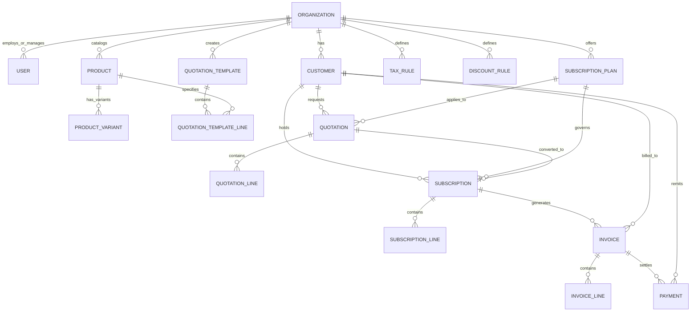

# Database Schema Specification

## Subscription Manager (Multi-Tenant Relational Schema)

**Document Status:** Approved Logical & Physical Schema Baseline  
**Database Engine:** PostgreSQL 16+  
**ORM:** SQLAlchemy 2.0 (Async/Declarative)  
**Migration Tool:** Alembic  

---

## 1. Schema Conventions & Data Integrity

1. **Multi-Tenancy Discriminator:** Every tenant-owned table contains `organization_id UUID NOT NULL REFERENCES organizations(id) ON DELETE RESTRICT`.
2. **Identifier Strategy:** Primary keys use PostgreSQL `UUID` (`gen_random_uuid()`) for distributed scalability and tamper-proof identifiers.
3. **Monetary Precision:** All prices, taxes, discounts, and balances use `NUMERIC(12, 2)`. Floating-point types are strictly forbidden.
4. **Timestamping:** All timestamp columns use `TIMESTAMPTZ` and default to `CURRENT_TIMESTAMP` in UTC.
5. **Auditability & Non-Destructive Archiving:** Customers, Products, Plans, and Invoices use soft flags (`is_active` or explicit terminal states) to prevent historical financial records from ever being orphaned.

---

## 2. Entity-Relationship Diagram



---

## 3. Table Definitions

### 3.1 `organizations`
Represents a tenant business entity (e.g. **Brightloop Software**).
```sql
CREATE TABLE organizations (
    id UUID PRIMARY KEY DEFAULT gen_random_uuid(),
    name VARCHAR(255) NOT NULL,
    slug VARCHAR(100) UNIQUE NOT NULL,
    currency VARCHAR(3) NOT NULL DEFAULT 'INR',
    timezone VARCHAR(50) NOT NULL DEFAULT 'Asia/Kolkata',
    created_at TIMESTAMPTZ NOT NULL DEFAULT CURRENT_TIMESTAMP,
    updated_at TIMESTAMPTZ NOT NULL DEFAULT CURRENT_TIMESTAMP
);
```

### 3.2 `users`
Accounts capable of authenticating. Enforces the three core roles.
```sql
CREATE TYPE user_role AS ENUM ('admin', 'staff', 'customer');

CREATE TABLE users (
    id UUID PRIMARY KEY DEFAULT gen_random_uuid(),
    organization_id UUID NOT NULL REFERENCES organizations(id) ON DELETE CASCADE,
    email VARCHAR(255) NOT NULL,
    hashed_password VARCHAR(255) NOT NULL,
    role user_role NOT NULL,
    full_name VARCHAR(255) NOT NULL,
    phone VARCHAR(50),
    is_active BOOLEAN NOT NULL DEFAULT TRUE,
    reset_token VARCHAR(255),
    reset_token_expires_at TIMESTAMPTZ,
    created_at TIMESTAMPTZ NOT NULL DEFAULT CURRENT_TIMESTAMP,
    updated_at TIMESTAMPTZ NOT NULL DEFAULT CURRENT_TIMESTAMP,
    CONSTRAINT uq_users_org_email UNIQUE (organization_id, email)
);
```

### 3.3 `customers`
Customer records. Can optionally link to a `users` record when the customer portal is enabled.
```sql
CREATE TABLE customers (
    id UUID PRIMARY KEY DEFAULT gen_random_uuid(),
    organization_id UUID NOT NULL REFERENCES organizations(id) ON DELETE RESTRICT,
    user_id UUID REFERENCES users(id) ON DELETE SET NULL,
    name VARCHAR(255) NOT NULL,
    email VARCHAR(255) NOT NULL,
    phone VARCHAR(50),
    company_name VARCHAR(255),
    billing_address TEXT,
    tax_id VARCHAR(50),
    is_active BOOLEAN NOT NULL DEFAULT TRUE,
    created_at TIMESTAMPTZ NOT NULL DEFAULT CURRENT_TIMESTAMP,
    updated_at TIMESTAMPTZ NOT NULL DEFAULT CURRENT_TIMESTAMP,
    CONSTRAINT uq_customers_org_email UNIQUE (organization_id, email)
);
```

### 3.4 `products` & `product_variants`
Stores products with name, type, sales price, cost price, notes, and variants with price surcharges.
```sql
CREATE TYPE product_type AS ENUM ('software', 'service', 'addon', 'physical');

CREATE TABLE products (
    id UUID PRIMARY KEY DEFAULT gen_random_uuid(),
    organization_id UUID NOT NULL REFERENCES organizations(id) ON DELETE RESTRICT,
    name VARCHAR(255) NOT NULL,
    product_type product_type NOT NULL DEFAULT 'software',
    sales_price NUMERIC(12, 2) NOT NULL DEFAULT 0.00,
    cost_price NUMERIC(12, 2) NOT NULL DEFAULT 0.00,
    notes TEXT,
    is_active BOOLEAN NOT NULL DEFAULT TRUE,
    created_at TIMESTAMPTZ NOT NULL DEFAULT CURRENT_TIMESTAMP,
    updated_at TIMESTAMPTZ NOT NULL DEFAULT CURRENT_TIMESTAMP
);

CREATE TABLE product_variants (
    id UUID PRIMARY KEY DEFAULT gen_random_uuid(),
    organization_id UUID NOT NULL REFERENCES organizations(id) ON DELETE RESTRICT,
    product_id UUID NOT NULL REFERENCES products(id) ON DELETE CASCADE,
    attribute_name VARCHAR(100) NOT NULL,    -- e.g. 'Brand', 'Tier'
    attribute_value VARCHAR(100) NOT NULL,   -- e.g. 'Odoo', 'Enterprise'
    price_extra NUMERIC(12, 2) NOT NULL DEFAULT 0.00, -- e.g. +560.00
    sku VARCHAR(100),
    created_at TIMESTAMPTZ NOT NULL DEFAULT CURRENT_TIMESTAMP,
    CONSTRAINT uq_variant_attr UNIQUE (product_id, attribute_name, attribute_value)
);
```

### 3.5 `subscription_plans`
Defines plans with billing frequencies, price, quantity minimums, availability, and lifecycle rules.
```sql
CREATE TYPE billing_interval AS ENUM ('daily', 'weekly', 'monthly', 'yearly');

CREATE TABLE subscription_plans (
    id UUID PRIMARY KEY DEFAULT gen_random_uuid(),
    organization_id UUID NOT NULL REFERENCES organizations(id) ON DELETE RESTRICT,
    name VARCHAR(255) NOT NULL,
    description TEXT,
    billing_interval billing_interval NOT NULL,
    interval_count INT NOT NULL DEFAULT 1,
    base_price NUMERIC(12, 2) NOT NULL,
    currency VARCHAR(3) NOT NULL DEFAULT 'INR',
    min_quantity INT NOT NULL DEFAULT 1,
    available_from DATE,
    available_until DATE,
    auto_close_on_expiry BOOLEAN NOT NULL DEFAULT TRUE,
    allow_early_close BOOLEAN NOT NULL DEFAULT TRUE,
    allow_pause BOOLEAN NOT NULL DEFAULT TRUE,
    allow_renewal BOOLEAN NOT NULL DEFAULT TRUE,
    is_active BOOLEAN NOT NULL DEFAULT TRUE,
    created_at TIMESTAMPTZ NOT NULL DEFAULT CURRENT_TIMESTAMP,
    updated_at TIMESTAMPTZ NOT NULL DEFAULT CURRENT_TIMESTAMP
);
```

### 3.6 `tax_rules` & `discount_rules`
Admin-controlled automated calculation rules.
```sql
CREATE TABLE tax_rules (
    id UUID PRIMARY KEY DEFAULT gen_random_uuid(),
    organization_id UUID NOT NULL REFERENCES organizations(id) ON DELETE RESTRICT,
    name VARCHAR(100) NOT NULL,              -- e.g. 'GST 18%', 'VAT 20%'
    rate NUMERIC(5, 2) NOT NULL,             -- e.g. 18.00
    is_active BOOLEAN NOT NULL DEFAULT TRUE,
    created_at TIMESTAMPTZ NOT NULL DEFAULT CURRENT_TIMESTAMP
);

CREATE TYPE discount_type AS ENUM ('fixed_amount', 'percentage');
CREATE TYPE discount_scope AS ENUM ('product', 'subscription');

CREATE TABLE discount_rules (
    id UUID PRIMARY KEY DEFAULT gen_random_uuid(),
    organization_id UUID NOT NULL REFERENCES organizations(id) ON DELETE RESTRICT,
    name VARCHAR(255) NOT NULL,
    discount_type discount_type NOT NULL,
    discount_value NUMERIC(12, 2) NOT NULL,
    min_purchase_amount NUMERIC(12, 2) DEFAULT 0.00,
    min_quantity INT DEFAULT 1,
    start_date DATE,
    end_date DATE,
    max_uses INT,                             -- NULL = unlimited
    times_used INT NOT NULL DEFAULT 0,
    scope discount_scope NOT NULL DEFAULT 'subscription',
    product_id UUID REFERENCES products(id) ON DELETE SET NULL, -- for specific product scope
    is_active BOOLEAN NOT NULL DEFAULT TRUE,
    created_at TIMESTAMPTZ NOT NULL DEFAULT CURRENT_TIMESTAMP
);
```

### 3.7 `quotation_templates` & `quotation_template_lines`
Standardized quotation templates for sales reps.
```sql
CREATE TABLE quotation_templates (
    id UUID PRIMARY KEY DEFAULT gen_random_uuid(),
    organization_id UUID NOT NULL REFERENCES organizations(id) ON DELETE RESTRICT,
    name VARCHAR(255) NOT NULL,
    validity_days INT NOT NULL DEFAULT 30,
    plan_id UUID NOT NULL REFERENCES subscription_plans(id) ON DELETE RESTRICT,
    notes TEXT,
    created_at TIMESTAMPTZ NOT NULL DEFAULT CURRENT_TIMESTAMP
);

CREATE TABLE quotation_template_lines (
    id UUID PRIMARY KEY DEFAULT gen_random_uuid(),
    template_id UUID NOT NULL REFERENCES quotation_templates(id) ON DELETE CASCADE,
    product_id UUID NOT NULL REFERENCES products(id) ON DELETE RESTRICT,
    variant_id UUID REFERENCES product_variants(id) ON DELETE SET NULL,
    quantity INT NOT NULL DEFAULT 1,
    unit_price NUMERIC(12, 2) NOT NULL
);
```

### 3.8 `quotations` & `quotation_lines`
Quotations prepared by sales reps and convertible to subscriptions.
```sql
CREATE TYPE quotation_status AS ENUM ('draft', 'quotation', 'confirmed', 'converted', 'cancelled');

CREATE TABLE quotations (
    id UUID PRIMARY KEY DEFAULT gen_random_uuid(),
    organization_id UUID NOT NULL REFERENCES organizations(id) ON DELETE RESTRICT,
    quotation_number VARCHAR(100) NOT NULL,
    customer_id UUID NOT NULL REFERENCES customers(id) ON DELETE RESTRICT,
    plan_id UUID NOT NULL REFERENCES subscription_plans(id) ON DELETE RESTRICT,
    template_id UUID REFERENCES quotation_templates(id) ON DELETE SET NULL,
    start_date DATE NOT NULL,
    expiry_date DATE NOT NULL,
    payment_terms VARCHAR(255),
    status quotation_status NOT NULL DEFAULT 'draft',
    subtotal NUMERIC(12, 2) NOT NULL DEFAULT 0.00,
    tax_amount NUMERIC(12, 2) NOT NULL DEFAULT 0.00,
    discount_amount NUMERIC(12, 2) NOT NULL DEFAULT 0.00,
    total_amount NUMERIC(12, 2) NOT NULL DEFAULT 0.00,
    created_at TIMESTAMPTZ NOT NULL DEFAULT CURRENT_TIMESTAMP,
    updated_at TIMESTAMPTZ NOT NULL DEFAULT CURRENT_TIMESTAMP,
    CONSTRAINT uq_quotation_number UNIQUE (organization_id, quotation_number)
);

CREATE TABLE quotation_lines (
    id UUID PRIMARY KEY DEFAULT gen_random_uuid(),
    quotation_id UUID NOT NULL REFERENCES quotations(id) ON DELETE CASCADE,
    product_id UUID NOT NULL REFERENCES products(id) ON DELETE RESTRICT,
    variant_id UUID REFERENCES product_variants(id) ON DELETE SET NULL,
    quantity INT NOT NULL DEFAULT 1,
    unit_price NUMERIC(12, 2) NOT NULL,
    tax_id UUID REFERENCES tax_rules(id) ON DELETE SET NULL,
    tax_amount NUMERIC(12, 2) NOT NULL DEFAULT 0.00,
    discount_amount NUMERIC(12, 2) NOT NULL DEFAULT 0.00,
    line_total NUMERIC(12, 2) NOT NULL
);
```

### 3.9 `subscriptions` & `subscription_lines`
Core recurring subscription records.
```sql
CREATE TYPE subscription_status AS ENUM ('draft', 'quotation', 'confirmed', 'active', 'paused', 'closed');

CREATE TABLE subscriptions (
    id UUID PRIMARY KEY DEFAULT gen_random_uuid(),
    organization_id UUID NOT NULL REFERENCES organizations(id) ON DELETE RESTRICT,
    subscription_number VARCHAR(100) NOT NULL,
    customer_id UUID NOT NULL REFERENCES customers(id) ON DELETE RESTRICT,
    plan_id UUID NOT NULL REFERENCES subscription_plans(id) ON DELETE RESTRICT,
    quotation_id UUID REFERENCES quotations(id) ON DELETE SET NULL,
    start_date DATE NOT NULL,
    expiry_date DATE NOT NULL,
    next_billing_date DATE NOT NULL,
    last_billed_date DATE,
    payment_terms VARCHAR(255),
    status subscription_status NOT NULL DEFAULT 'draft',
    auto_close_on_expiry BOOLEAN NOT NULL DEFAULT TRUE,
    allow_early_close BOOLEAN NOT NULL DEFAULT TRUE,
    allow_pause BOOLEAN NOT NULL DEFAULT TRUE,
    allow_renewal BOOLEAN NOT NULL DEFAULT TRUE,
    created_at TIMESTAMPTZ NOT NULL DEFAULT CURRENT_TIMESTAMP,
    updated_at TIMESTAMPTZ NOT NULL DEFAULT CURRENT_TIMESTAMP,
    CONSTRAINT uq_subscription_number UNIQUE (organization_id, subscription_number)
);

CREATE TABLE subscription_lines (
    id UUID PRIMARY KEY DEFAULT gen_random_uuid(),
    subscription_id UUID NOT NULL REFERENCES subscriptions(id) ON DELETE CASCADE,
    product_id UUID NOT NULL REFERENCES products(id) ON DELETE RESTRICT,
    variant_id UUID REFERENCES product_variants(id) ON DELETE SET NULL,
    quantity INT NOT NULL DEFAULT 1,
    unit_price NUMERIC(12, 2) NOT NULL,
    tax_id UUID REFERENCES tax_rules(id) ON DELETE SET NULL,
    discount_rule_id UUID REFERENCES discount_rules(id) ON DELETE SET NULL,
    is_addon BOOLEAN NOT NULL DEFAULT FALSE,
    created_at TIMESTAMPTZ NOT NULL DEFAULT CURRENT_TIMESTAMP
);
```

### 3.10 `invoices` & `invoice_lines`
Generated invoices moving through `Draft → Confirmed → Paid`.
```sql
CREATE TYPE invoice_status AS ENUM ('draft', 'confirmed', 'paid', 'cancelled');

CREATE TABLE invoices (
    id UUID PRIMARY KEY DEFAULT gen_random_uuid(),
    organization_id UUID NOT NULL REFERENCES organizations(id) ON DELETE RESTRICT,
    invoice_number VARCHAR(100) NOT NULL,
    subscription_id UUID NOT NULL REFERENCES subscriptions(id) ON DELETE RESTRICT,
    customer_id UUID NOT NULL REFERENCES customers(id) ON DELETE RESTRICT,
    issue_date DATE NOT NULL,
    due_date DATE NOT NULL,
    status invoice_status NOT NULL DEFAULT 'draft',
    subtotal NUMERIC(12, 2) NOT NULL DEFAULT 0.00,
    tax_amount NUMERIC(12, 2) NOT NULL DEFAULT 0.00,
    discount_amount NUMERIC(12, 2) NOT NULL DEFAULT 0.00,
    total_amount NUMERIC(12, 2) NOT NULL DEFAULT 0.00,
    amount_paid NUMERIC(12, 2) NOT NULL DEFAULT 0.00,
    amount_due NUMERIC(12, 2) NOT NULL DEFAULT 0.00,
    created_at TIMESTAMPTZ NOT NULL DEFAULT CURRENT_TIMESTAMP,
    updated_at TIMESTAMPTZ NOT NULL DEFAULT CURRENT_TIMESTAMP,
    CONSTRAINT uq_invoice_number UNIQUE (organization_id, invoice_number)
);

CREATE TABLE invoice_lines (
    id UUID PRIMARY KEY DEFAULT gen_random_uuid(),
    invoice_id UUID NOT NULL REFERENCES invoices(id) ON DELETE CASCADE,
    product_id UUID NOT NULL REFERENCES products(id) ON DELETE RESTRICT,
    variant_id UUID REFERENCES product_variants(id) ON DELETE SET NULL,
    description VARCHAR(255) NOT NULL,
    quantity INT NOT NULL DEFAULT 1,
    unit_price NUMERIC(12, 2) NOT NULL,
    tax_rate NUMERIC(5, 2) NOT NULL DEFAULT 0.00,
    tax_amount NUMERIC(12, 2) NOT NULL DEFAULT 0.00,
    discount_amount NUMERIC(12, 2) NOT NULL DEFAULT 0.00,
    line_total NUMERIC(12, 2) NOT NULL
);
```

### 3.11 `payments`
Offline multi-method recording and online Razorpay records.
```sql
CREATE TYPE payment_method AS ENUM ('bank_transfer', 'cheque', 'cash', 'razorpay', 'other');
CREATE TYPE payment_status AS ENUM ('pending', 'succeeded', 'failed', 'refunded');

CREATE TABLE payments (
    id UUID PRIMARY KEY DEFAULT gen_random_uuid(),
    organization_id UUID NOT NULL REFERENCES organizations(id) ON DELETE RESTRICT,
    invoice_id UUID NOT NULL REFERENCES invoices(id) ON DELETE RESTRICT,
    customer_id UUID NOT NULL REFERENCES customers(id) ON DELETE RESTRICT,
    payment_method payment_method NOT NULL,
    amount NUMERIC(12, 2) NOT NULL,
    payment_date DATE NOT NULL DEFAULT CURRENT_DATE,
    note TEXT,
    status payment_status NOT NULL DEFAULT 'succeeded',
    razorpay_order_id VARCHAR(100),
    razorpay_payment_id VARCHAR(100),
    razorpay_signature VARCHAR(255),
    created_at TIMESTAMPTZ NOT NULL DEFAULT CURRENT_TIMESTAMP
);
```

---

## 4. Performance Indexes (Sub-2s Response Guarantee)

```sql
-- Indexes for Billing Day automated sweeps
CREATE INDEX idx_subs_billing_sweep 
ON subscriptions (organization_id, status, next_billing_date)
WHERE status = 'active';

-- Indexes for Customer Portal filtering
CREATE INDEX idx_subs_customer 
ON subscriptions (organization_id, customer_id, status);

CREATE INDEX idx_invoices_customer 
ON invoices (organization_id, customer_id, status);

-- Indexes for Finance Lead / Overdue chasing
CREATE INDEX idx_invoices_overdue 
ON invoices (organization_id, status, due_date)
WHERE status = 'confirmed';

-- Indexes for Payments reconciliation
CREATE INDEX idx_payments_invoice 
ON payments (organization_id, invoice_id);
```
